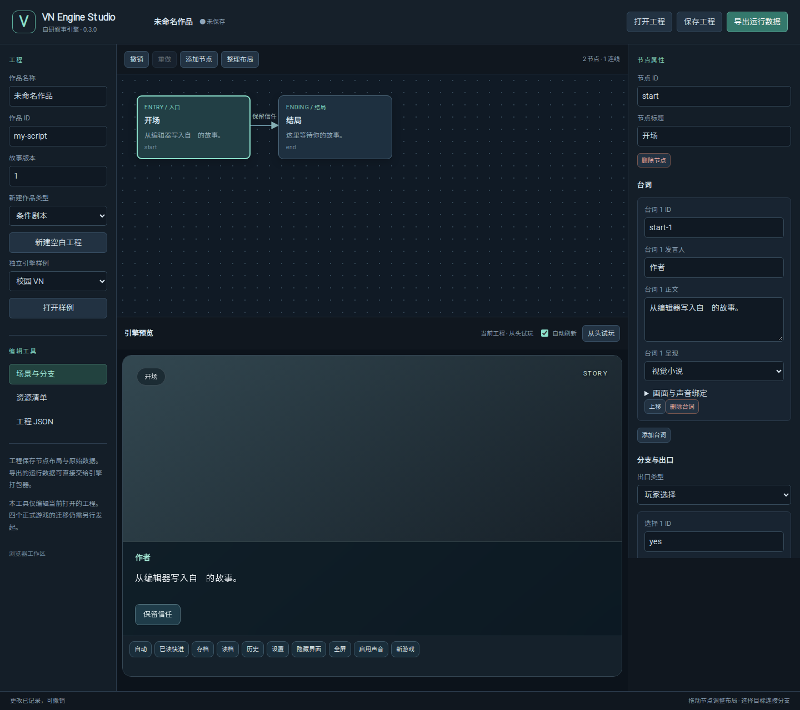

# VN Engine v2

**自研叙事引擎 · v0.3.0 alpha**

从《雨停之前》《湿性愈合》《“网”恋》《回路》中沉淀规则，并补齐自己的剧本解释器、播放调度、画面渲染、输入控制、媒体与离线打包。现在能直接执行、绘制和打包作品；主运行链无需 Ren’Py 或其他游戏引擎。



迁移是最后阶段，**仅在用户主动、明确提出后执行**；当前持续优化引擎本体。

0.3 新增 [可视化编辑器](docs/EDITOR.md) 与 [Windows 原生宿主](docs/WINDOWS.md)。编辑器与桌面窗口共用同一套自研执行、资源和渲染链。此前的播放优化见 [0.2.1 记录](docs/OPTIMIZATION-0.2.1.md)。

## 已实现

| 能力 | 实现 |
| --- | --- |
| 剧本执行 | 自研 ScriptEngine：数值/布尔状态、跳转、条件分支、选项回应、结局、路线重建 |
| 不同玩法 | 校园 VN、聊天/通话、调查/证据/推理、Rain 结构化剧本四种入口 |
| 自研播放器 | 逐字阅读、停顿、自动、已读快进、后台/面板/隐藏暂停、访问隔离 |
| 画面与演出 | 背景、立绘、按段落 CG、聊天气泡、通话视图、文书、热点、淡入/闪白/震屏 |
| 声音 | 循环音乐、环境音、逐段语音与动作音效；换场景取消、面板恢复、缺资源继续 |
| 系统 | 独立存档、损坏保留、历史搜索/重读、设置、导入导出、全屏、键盘与触控 |
| 可视化编辑器 | 节点图、台词/分支/资源属性、撤销重做、草稿恢复、真实预览与格式导出 |
| Windows 宿主 | 原生窗口、文件选择/保存、资源另存、作品哈希检查、持久化、全屏与最小化暂停；实际状态见验证记录 |
| 独立作品构建 | 自研运行模块 + 本地项目/资源 + PWA + 文件哈希；支持子目录与断网重开 |

核心为 TypeScript，无 React/Electron/Tauri 运行依赖。浏览器是绘制与媒体宿主；状态与执行规则由引擎控制。原 Ren’Py 编译器保留为兼容工具。

## 运行自研引擎

需要 Node.js 22+、npm；完整检查还需 Python 3.10+。

```bash
npm ci
npm run demo
```

打开 **http://127.0.0.1:4173/engine/**，切换四种玩法。可视化编辑器在 **http://127.0.0.1:4173/editor/**，原 0.1 诊断页保留在 `/`。

Windows 下载、运行与本地构建见 [Windows 使用说明](docs/WINDOWS.md)。

## 打包独立作品

```bash
npm run build:game -- examples/runtime/rain.json build/my-game
python -m http.server 8000 --directory build/my-game
```

访问 http://127.0.0.1:8000，下载完成后可离线游玩。输出目录必须新建或为空。构建结果包含自己写的运行模块和实际资源，不依赖此开发服务器。CI 同时构建四份独立样例并保留为 `vn-engine-standalone-samples` artifact。

```ts
import { mountGame } from '@aureliuswu/vn-engine-v2';
const game = mountGame(document.getElementById('game')!, project, {
  baseURL: new URL('./', location.href), storage: localStorage
});
// 路由实际卸载时：game.dispose();
```

目前 `private: true`，通过仓库构建或本地依赖接入，尚未发布 npm 包。

## 验证

```bash
npm run check
npx playwright install chromium
npm run test:browser
```

- 74 项 Node、6 项 Python、31 项浏览器场景通过；Windows 自包含构建与实际原生运行、文件读写和进程重启检查也已通过。
- 自研 VM 对照 Rain 原作：26 场景、16 条完整路线、6692 次段落访问；原台词/选项回应顺序、数值/布尔状态、结局与存档重放一致。
- 浏览器覆盖真实画面、聊天/通话、热点与文书、调查解锁、音频等待、缺图恢复、移动布局、真实断网和独立产物子目录部署。
- 原 0.1 的四作提取层对照证据保留；来源文件与新增自研模块分别记录。

完整证据和范围见 [验证记录](docs/VALIDATION.md)。自研样例的 SVG 与合成测试音用于验证能力，四作正式美术和声音继续在各自仓库维护。

## 使用与后续

[自研运行时说明](docs/SELF-RUNTIME.md) · [架构](docs/ARCHITECTURE.md) · [四作接入与兼容](docs/MIGRATION.md) · [来源清单](docs/provenance.json) · [许可](THIRD_PARTY_NOTICES.md)

当前已形成可独立运行和打包的自研 alpha。可视化编辑器和 Windows 宿主已提供可用初版；复杂动画时间线、协作编辑与正式安装发行仍需后续完善。四个正式项目保持原运行链；迁移不会作为自动推进步骤，需等用户主动提出。
