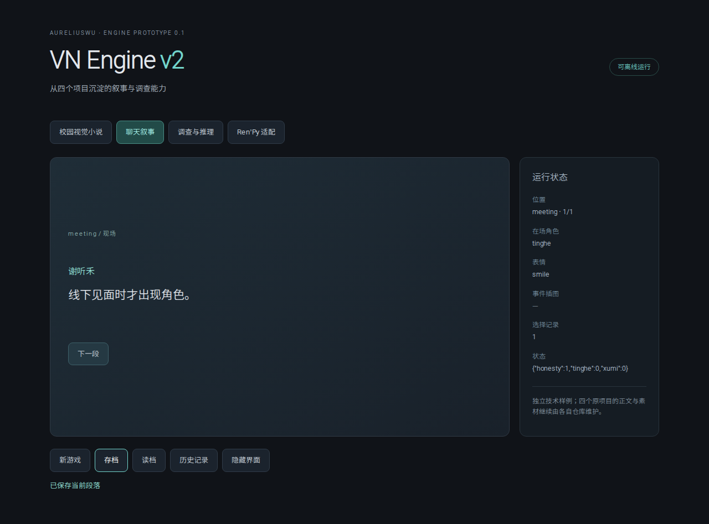

# VN Engine v2

从《雨停之前》《湿性愈合》《“网”恋》《回路》中抽取的叙事引擎雏形，当前版本 **0.1.0**。

已包含可运行代码、三种 Web 玩法样例、一个原生 Ren’Py 编译样例、来源记录和回归测试。四作保留各自的剧情、视觉形式和存档身份；本轮未修改四作，也未将它们迁移到这个仓库。



## 已沉淀的能力

| 模块 | 能力 | 主要来源 |
| --- | --- | --- |
| `src/narrative/` | 段落推进、选项、数值、结局解析、章节停顿、路线重放与安全重读 | Healing、NetLove |
| `src/investigation/` | 调查循环、证据收集、证据门槛、推理失败与重试、章节解锁 | Circuit |
| `src/adapters/` | 三作原生数据形状、身份与规则的适配入口 | Healing、NetLove、Circuit |
| `adapters/renpy/` | 结构化剧本校验、状态路线枚举、标准 Ren’Py DSL 编译 | Rain |
| `src/presentation/` | 读档/历史重读时重建表情，匿名聊天隐藏人物，按段落触发 CG | Healing、NetLove |
| `src/audio/` | 限额音乐缓存、换场景取消下载、迟到回调隔离、配音暂停/重播与台词绑定 | NetLove；同实现见 Healing、Circuit |
| `src/history/`、`src/lifecycle/` | 已读搜索、面板/后台/隐藏界面的阅读门控、同段落的新访问身份 | 四作既有交互经验 |
| `src/storage/` | 原生存档解析、从选择重算状态、独立命名空间、失败保留与批量写入回滚 | Healing、NetLove、Circuit |
| `tools/pwa.mjs`、`tools/validate-graph.mjs` | 按实际文件指纹生成离线包、作用域隔离、静态图检查 | NetLove、Rain |

TypeScript 核心无 React、Electron、Tauri 运行时依赖，可由不同界面层调用。Ren’Py 继续承担《雨停之前》的原生运行、回滚和存档。

## 运行

需要 Node.js 22+、npm，以及用于原生适配器检查的 Python 3.10+。

```bash
npm ci
npm run check
npm run demo
```

打开 `http://127.0.0.1:4173`，可切换校园视觉小说、聊天叙事和调查推理。示例使用独立的 `vn-engine-demo:*` 存档与离线缓存。也可查看 Ren’Py 适配入口。

浏览器交互及真实断网复验：

```bash
npx playwright install chromium
npm run test:browser
```

原生编译样例：

```bash
python -m adapters.renpy --story examples/renpy/story.json --out examples/renpy/game
```

生成后，用 Ren’Py 8.5.3 SDK 打开 `examples/renpy`。仓库包含最小宿主 screen；SDK 本身未打包。

## 调用核心

```ts
import { NarrativeEngine, createSaveCodec } from '@aureliuswu/vn-engine-v2';

const engine = new NarrativeEngine({
  game: 'my-game', storyVersion: 'my-story-v1', entry: 'start', stats: {},
  scenes: [{ id: 'start', lines: [{ id: 'start-001', speaker: '旁白', text: '开始。' }], ending: 'done' }]
});
const state = engine.newGame();
const save = createSaveCodec(engine).encode(state);
```

目前保持 `private: true`，通过仓库构建与本地依赖接入；尚未发布 npm 包。

## 验证与边界

- 35 项 Node 测试、6 项 Python 测试、8 项浏览器场景通过。
- 原码对照：Healing 65 场景 / 1296 条完整路线；NetLove 43 场景 / 288 条完整路线。
- Circuit 11 章 / 1521 个可达调查状态 / 1731 次动作转换一致。
- Rain 26 场景 / 16 条路线，生成脚本与原编译器逐字一致。
- 浏览器验证包含存读档、重读改选、聊天/通话、证据门槛、失败重试、章节解锁、390px 布局和真实断网重开。

以上记录对应 [来源快照](docs/provenance.json)；详细证据见 [验证记录](docs/VALIDATION.md)。尚未执行此仓库的 Windows 客户端或 Ren’Py SDK 运行验收，也未接入四作的正式发行流程。

本阶段形成可复用核心与适配接口。可视化编辑器、完整渲染/演出系统、原项目的全部生产工具链与新游戏的发行器仍需后续实现。

继续阅读：[架构与接口](docs/ARCHITECTURE.md) · [抽取范围](docs/EXTRACTION.md) · [接入与兼容](docs/MIGRATION.md) · [后续工作](docs/ROADMAP.md) · [来源与许可](THIRD_PARTY_NOTICES.md)。
