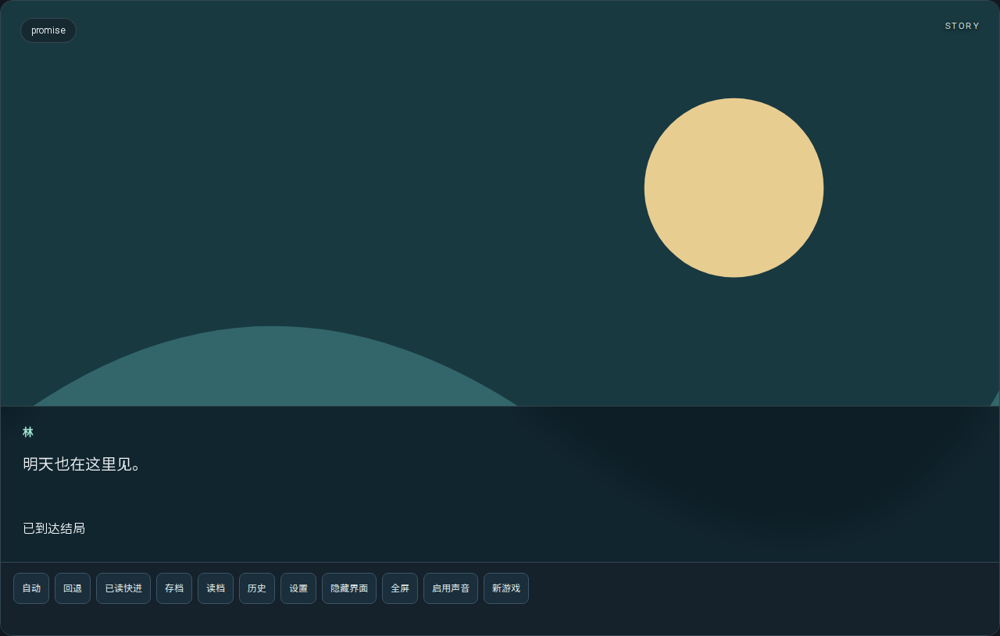
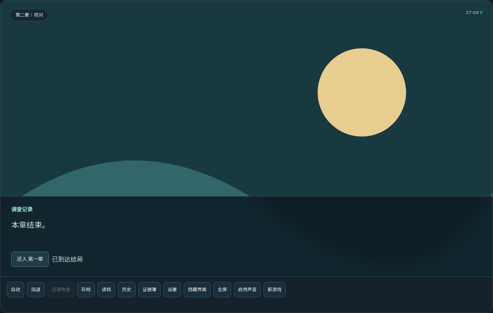

# R1「AI 开发接口」v0.5.0 验证

日期：2026-10-28。基线 `6480041646ee9e277db9d9f3ad842ac9a27bd296`；最终实现 `e7035bc38abe3554babf9a4c1518d7a80d82a7ac`。后续收尾提交只保存文档、机器记录和实际截图；本页所有 CI 和构建身份明确绑定该实现，不把旧提交结果冒充收尾提交的新执行。

R1 技术闭环完成：开发 Agent 可以通过统一接口理解工程、批量修改、验证、实际预览与独立打包。四作与 RESET 未迁移，正式剧情、资产和玩家数据未改写。协议、使用方法、全部操作、错误码、预算和恢复流程见 [AI_DEVELOPMENT.md](AI_DEVELOPMENT.md)；可检查的摘要见 [r1-validation.json](r1-validation.json)。

## 编译、浏览器与原生分别验收

| 范围 | 实际执行与结果 | 提交证据 |
| --- | --- | --- |
| 核心 / 编译 | npm run check：180 Node、6 Python、149 来源、静态 schema 与四样例结构校验通过；TypeScript 编译通过 | [Engine checks](https://github.com/AureliusWu/VN-Engine-v2/actions/runs/40620862330)，core job |
| 浏览器与编辑器 | 完整 npm run test:browser，含所有 Studio / 作者控件专项及新增 Agent SDK / CLI E2E；四个生成包实际子目录部署、关闭页面后断网重开通过 | 同一 run 的 browser job |
| Windows 编译 | .NET 10 自包含 win-x64 publish 通过；npm / 锁文件 / ENGINE_VERSION / csproj / 实际程序 / Studio 与游戏 manifest 均为 0.5.0 | [Windows native host](https://github.com/AureliusWu/VN-Engine-v2/actions/runs/40620862119) |
| Windows CLI | Node 22 的真实 CLI 子进程完成 26 次无预览流程调用，包含四模板、两条作品流程、测试、构建、非法请求、硬超时、过期 SHA、失败批次保留与重复请求去重 | 同一 Windows run 的 AI CLI step；CLI_REPORT.json |
| Windows 原生执行 | WebView2 原生文件 IO / 策略、Studio 首次启动和完整进程重启、独立游戏首次启动和重启均通过；版本从实际 exe 读取并与 manifest 对比 | Windows 原生 JSON / PNG 和 version-identity.json |
| 四样例 QA | 10 条用例、11 个声明结局、73 次逐步标准 save/restore；文件、实际解码和带提交身份的独立包检查全部 PASS | 同一 Engine run 的 alpha-qa-reports |

本地完整 browser 和显式 npm run test:editor 在 `a0ba1d3` 通过。之后只收紧 Node 文件宿主的字节 / 锁边界；最终实现重新执行完整 CI（包括全部编辑器专项），本地也在最终提交重跑 SDK / CLI 真实预览、子目录断网和四样例 QA。记录不以 Linux 浏览器代替原生 Windows 执行。

## 两条独立端到端流程

`node tools/agent-example.mjs <新目录>` 和 `--cli` 分别通过 Node SDK 与 CLI 完成同一组 28 次调用。工程内容全部由接口生成，未手动打开 Studio 编辑数据。文件层只另行提供原创技术 SVG 和带许可的字体。

| 流程 | 实际内容 | 路线与产物 |
| --- | --- | --- |
| A：分支 Galgame（script 模板） | 创建 → 改台词 → 新变量 → 选项有序效果 → 条件路由 → 两个结局 → 资源 / 演出绑定 → 用例 → dry-run / apply → refs / validate | 两条用例 PASS、7 次存读档检查；真实 Chromium 截图、独立 PWA 包；SDK / CLI 各自完成 |
| B：调查 | 创建 → 添加第二章 → 证据 / 动作 / 门控 → 重命名章节与证据 → 检查引用 → 跨章路线 | 两条用例 PASS、10 次存读档检查；真实跨章截图与独立包；SDK / CLI 各自完成 |

VN 与 chat 模板也通过 init / 编辑 / validate / test / preview / build。Rain 原格式通过 inspect / validate / test / preview / build，原运行入口未替换。四个 SDK / CLI 分支和调查包分别部署在 `/stories/sdk-script/`、`/stories/sdk-investigation/`、`/stories/cli-script/`、`/stories/cli-investigation/`，下载完成后关闭页面、切断网络、新页面重新进入均能启动。

源字节 SHA256：

- 分支作品：`194d8186106c8a72257ee680a07213058f825b3d589f4a9ed69a56793dec9351`。
- 调查作品：`028726615f19164857f5d2c285f32d0da45368fe29156f0e11de3ac0381c3d4d`。

源文件、test 报告、preview 报告与 build manifest 的源 SHA 已逐一核对一致；两种 transport 得到相同作品源字节与内容指纹。每份 manifest 记录游戏版本、0.5.0 引擎版本、确切提交、文件清单与 SHA。截图仅代表声明技术场景，未作为人工美术 / 剧情验收。

## 失败、并发与存储边界

- 失败批次、断链、资源缺失 / 校验和不符、非法类型和参数、过期源 SHA 均拒绝修改原工程。输入 / 响应过大、路线操作耗尽、预览与 Worker 超时、取消均不标成功，stdout 保持 JSON，退出码保持 0 / 1 / 2 / 3。
- 实际子进程分别在 prepared 和文件 rename 后退出，恢复依据当前字节确认未应用 / 已应用；重复请求不重复追加。另验证回执最终写入失败时报告 applied=true 和真实新 SHA，重试只核对回执；错误锁元数据中的外部路径不会被恢复逻辑用来清理其他文件。
- dry-run 不写工程 / 日志；协作锁、提交前 SHA 复核与 prepared / committed 回执保护正式写入。源冲突、旧回执后的其他更改、同 ID 不同输入和不确定状态分别明确拒绝。超时写入可能已完成时如实返回 unknown / recoveryRequired。
- SDK 使用同一作者模型、解释器、校验与打包器，保留作者扩展字段和编辑器外层扩展；30 种操作按稳定 ID 定位。悬空演出目标由共享作者校验拒绝，stage.remove 可在批内清理失效绑定。
- 路线从真实开场执行，每步经过标准 save/restore 一致性核对。预览使用真实 createProject / DOMRenderer 与合法动作，最终状态与回归器实际结果比对；没有直接注入数值或历史。预览使用独立浏览器上下文且 localStorage 访问被拒绝，未写玩家 Save / Meta / 已读。
- 项目 / EditorDocument / Save 保留 schema 1，沿用原驱动重建；game、故事版本、稳定 ID 与原生存档键没有自动迁移。纯模块导入不访问 DOM、存储、磁盘或音频设备。

本轮发现并修复了隐藏占位图片被误解码、Linux 无中文字体的不可读截图、stdin/eval 参数误继承到 Worker、BOM 被剥离而导致源哈希不对应原字节等问题。现在工程文件要求无 BOM 的合法 UTF-8，CRLF 与中文按真实字节计算 SHA；BOM / 错误编码明确拒绝并保留原文件。首次本地四样例包未传提交身份，被校验拒绝；最终绑定上述确切提交重建后通过，没有降低检查。

## 产物与边界

Artifact 链接和压缩包 digest 记录在 r1-validation.json。

| CI 产物 | 下载 |
| --- | --- |
| alpha-qa-reports | [artifact 12787008415](https://github.com/AureliusWu/VN-Engine-v2/actions/runs/40620862330/artifacts/12787008415) |
| engine-browser-evidence | [artifact 12786754570](https://github.com/AureliusWu/VN-Engine-v2/actions/runs/40620862330/artifacts/12786754570) |
| vn-engine-standalone-samples | [artifact 12786424304](https://github.com/AureliusWu/VN-Engine-v2/actions/runs/40620862330/artifacts/12786424304) |
| VNEngine-Studio-win-x64 | [artifact 12786859364](https://github.com/AureliusWu/VN-Engine-v2/actions/runs/40620862119/artifacts/12786859364) |
| windows-native-evidence | [artifact 12786844321](https://github.com/AureliusWu/VN-Engine-v2/actions/runs/40620862119/artifacts/12786844321) |

engine-browser-evidence 包含两种 transport 的 TRANSCRIPT.json、源工程、实际 PNG、PREVIEW_REPORT、ROUTE_REPORT、独立包和总报告；alpha-qa-reports 包含四样例源绑定 QA / 路线 / manifest。Windows artifact 包含实际 0.5.0 portable 程序和单独原生 / CLI 证据。CI artifact 有保留期限，源代码与样例脚本可重建；本页两张真实截图保留在仓库。

技术接口与开发包验收 PASS；四样例的正式美术、人工 QA 和作品级发布状态继续 BLOCKED。预览默认 reduced motion、不开音频设备，不能代替完整动画、声音、实体设备、审美或剧情验收。系统文件对话框使用 CI 预设路径，未冒充人工点击。

文件事务使用合作锁和同目录 fsync / rename；不承诺不合作写入者或断电条件下的数据库级事务。回执最多 128 批 / 8 MB，归档后不承诺旧请求无限去重。本轮提供仓库内本地 SDK / CLI，没有发布 npm 包或远程服务。

断点恢复：保留原请求，读取当前工程与 journal；相同 requestId、输入摘要和匹配的前后 SHA 才能重试；死锁可给原请求加 recover=true，活锁不强拆。出现 RECOVERY_REQUIRED / REPLAY_CONFLICT 时先保存当前字节和回执，基于当前 SHA 用新 ID 明确修复。详见 AI_DEVELOPMENT.md 的完整示例与恢复步骤。R1 完成后停止，不自动推进 R2 或迁移。
