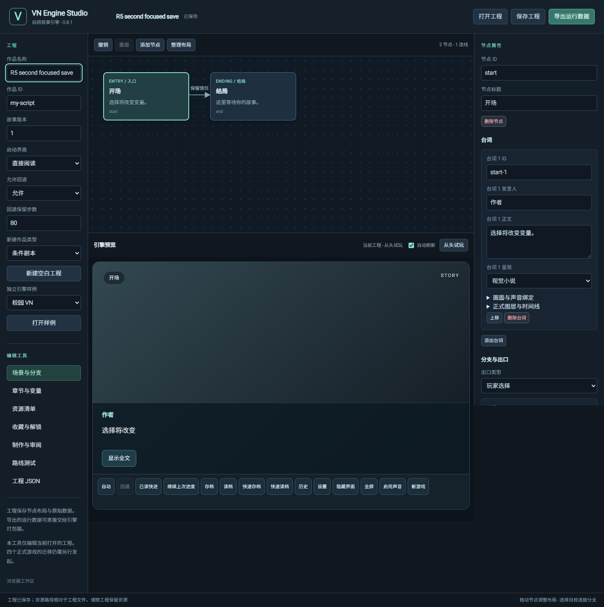

# R5 · 0.8.1 alpha 验证

基线：`622615a39ea05d446502d733c27055d5415f4411`。本轮计划见 [R5_PLAN.md](R5_PLAN.md)。

## 实机发现

2026-10-29 在本机 Windows 的 Edge 操作实际 `http://127.0.0.1:4173/editor/` 与 `/engine/`，没有使用四作的正式数据。

- Studio：作品名称输入后保持焦点并 Ctrl+S，旧版显示“工程已保存”但工程标题仍为旧值。确定性下载回归进一步核对保存字节。
- 播放器：校园样例鼠标点击“下一段”，焦点成为 BODY、离开引擎，按数字 1 后选项和页面不变。
- 其他异步 / 音频 / 审核故障通过新增的受控回归定位；实际听感与实体移动设备不据此标为已验收。

## 实现与本地结果

2026-10-30 完成 0.8.1 alpha 稳定性修复。实现与测试提交为 `8cdab361dd41bdb1e9258f45603b7d6c9a1bf62a`；问题范围及回归映射见 [R5_BUGS.md](R5_BUGS.md)。后续交付记录提交只更新文档与截图，不把旧结果冒充新一次实现测试。

| 检查 | 实际结果 |
| --- | --- |
| 本机 Edge 156 完整 `npm run test:browser` | 通过；包括所有旧功能、R1—R4、独立包 / Studio 子目录断网新页及 R5 专项 |
| 本机完整 `npm run test:editor` | 通过；包括保存字节、字段错误修复、同步按钮兼容、变量 / 章节、制作审阅与草稿恢复 |
| R5 浏览器专项 | Studio 10 项、运行时 / 实际 HTML 音频 4 项、反馈草稿 4 项；终审新增 5 组失败 / 恢复 / 读取顺序检查均通过 |
| 来源、schema、四份样例 | 178 项来源、执行契约和开发工程校验通过；新增模块保留为 `new` |
| 本地 `npm run check` | 225 项 Node 中 221 通过，4 项在符号链接场景的关键断言前因夹具创建 EPERM 中断；6 项 Python 另行执行通过。没有改 OS 权限或跳过断言，完整核心以 Linux CI 为准 |
| 独立审查 | 两名非作者代理检查本轮实现；发现的悬空字段与反馈草稿缺口已修正，无剩余阻断项 |

此截图来自本机独立 Edge 回归，不冒充人工操作截图。实机控制工具后续因无法可靠确认当前浏览器 URL 停止，本轮没有声称修后人工逐项复测或本地原生宿主人工操作。

## Engine 确切提交证据

[Engine run 40909572433](https://github.com/AureliusWu/VN-Engine-v2/actions/runs/40909572433) 全绿：225 项 Node、6 项 Python、178 项来源与 schema、完整浏览器、完整 Studio、四样例 QA 均实际执行成功。与 Windows 相同，实际检出 / 构建身份为 `8124b65f3333ea319a2f221975ed09e244dd3de9`，PR head 为 `8cdab361dd41bdb1e9258f45603b7d6c9a1bf62a`。

已下载并核对两份 GitHub 外层 artifact ZIP：

| 产物 | 字节 / SHA256 |
| --- | --- |
| [四样例 QA 12912214591](https://github.com/AureliusWu/VN-Engine-v2/actions/runs/40909572433/artifacts/12912214591) | 64443 / `444ea986770bcd6dd955d0e2567c0abae2e4dfe47329c4cade2fff1ddaa65670` |
| [R5 专项 12913432524](https://github.com/AureliusWu/VN-Engine-v2/actions/runs/40909572433/artifacts/12913432524) | 1185278 / `1bd6fad416d993f7799579137e5114d05e97b08e95b6a5036afeed3a9f5ff21f` |

四份实际 QA 的 route / files / decoding / build 子项均 PASS；10 条用例覆盖 11 个声明结局，完成 73 次存读档检查，四份构建 manifest 均绑定上述实际检出身份。正式内容总状态仍为 BLOCKED，样例素材仍 DRAFT。专项 ZIP 的 Studio 10 项、运行时 4 项、反馈草稿 4 项及两次完整套件产生的终审 5 组报告均 PASS。详细机器记录见 [r5-validation.json](r5-validation.json)。

## Windows 确切提交证据

[Windows run 40909572717](https://github.com/AureliusWu/VN-Engine-v2/actions/runs/40909572717) 全部通过：31 项既有 Node 专项、8 项媒体 Node 专项、新增 R5 浏览器专项、CLI 与真实素材流程、自包含发布、实际 WebView2 和完整进程重启。

PR head 为 `8cdab361dd41bdb1e9258f45603b7d6c9a1bf62a`，CI 实际检出 / 构建身份为 PR merge-test `8124b65f3333ea319a2f221975ed09e244dd3de9`；程序、Studio、独立作品均为 0.8.1。已下载并读取 host-policy、studio-first、studio-restart、game-first、game-restart、version-identity 六份 JSON，全部 `passed`。

| 产物 | 字节 / SHA256 |
| --- | --- |
| [Windows 便携包 12913276964](https://github.com/AureliusWu/VN-Engine-v2/actions/runs/40909572717/artifacts/12913276964) | GitHub 外层 artifact ZIP：64264368 / `4458a66bd27f3dd2287720b0ffd2d76ad8439e0b053c218ac4b1ff06f8ec6f9d`；仅核对远端元数据 |
| [原生证据 12912738585](https://github.com/AureliusWu/VN-Engine-v2/actions/runs/40909572717/artifacts/12912738585) | GitHub 外层 artifact ZIP：4729180 / `9df68c02d98298f6751e867bed4c12fce224c6f4eaabaedc5b46424aadb5113f`；本地 ZIP 与 GitHub digest 一致 |

系统文件对话框使用 CI 预设路径，与真实原生执行分别记录。未执行主观听感或实体移动设备验收；实际音频检查证明播放生命周期与位置，不代表声音内容质量。四作未迁移，未创建 GitHub Release。

## 保留的失败与修正

- 首轮本地全量在旧 authoring 测试要求无效输入仍导出旧数据时失败。按 R5 合同补充阻断 / 输入保留 / 修正后完整字节一致的回归，并对工作台的旧类型 / 边界 / 效果预期作相同调整。
- 首轮 Engine run 40907811878 的 225 项 Node 与 6 项 Python 通过，但最后制作面板变更的来源哈希未刷新；已补齐并重新核对 178 项来源。
- Engine run 40908495514 的核心通过，旧 creative 浏览器断言把合法 SE 续播产生的第二次 playing 当作重播而失败。修订为实际对象身份、暂停位置 / 时间推进及读档不增播放调用；没有关闭续播或放宽一次性访问规则。
- PR #1 最终 head `7feafbc1c1a8beff2d860aea3fe035fa0f80e816` 的 [Engine 40911487059](https://github.com/AureliusWu/VN-Engine-v2/actions/runs/40911487059) 和 [Windows 40911487427](https://github.com/AureliusWu/VN-Engine-v2/actions/runs/40911487427) 均通过并合并。合并提交 `8fbb6ebb6df6ca3b7571a6256f95cf7e32ec5813` 的 [Windows 40980122266](https://github.com/AureliusWu/VN-Engine-v2/actions/runs/40980122266) 通过，但 [Engine 40980122043](https://github.com/AureliusWu/VN-Engine-v2/actions/runs/40980122043) 在完整浏览器通过后的第二次 Studio 套件暴露目录绑定测试时序问题：`setInputFiles` 返回不代表 `File.text()` 与工程替换完成，立即绑定目录会递增工作区版本并取消迟到打开，旧校园背景又能满足旧 `naturalWidth > 0` 等待，最后得到 44 个资源错误。
- 收尾修正仅涉及测试与记录：为目录工程设置独立标题，用受控 `File.text()` 屏障确保覆盖慢读取，释放后等待工程身份再绑定目录；预览要求实际 400×200 图片，导出再核对标题、资源和相对路径。本机 `node tests/editor-browser.mjs` 完整 10 组通过，不以重跑失败 CI 代替修正；运行时代码保持不变。

最终交付以收尾修正 PR 与合并后 [main 的 Engine / Windows 检查](https://github.com/AureliusWu/VN-Engine-v2/actions?query=branch%3Amain) 再次确认；本页的确切实现证据不沿用 R4，保留历史失败而不把第一次合并的失败 CI 标为通过。
