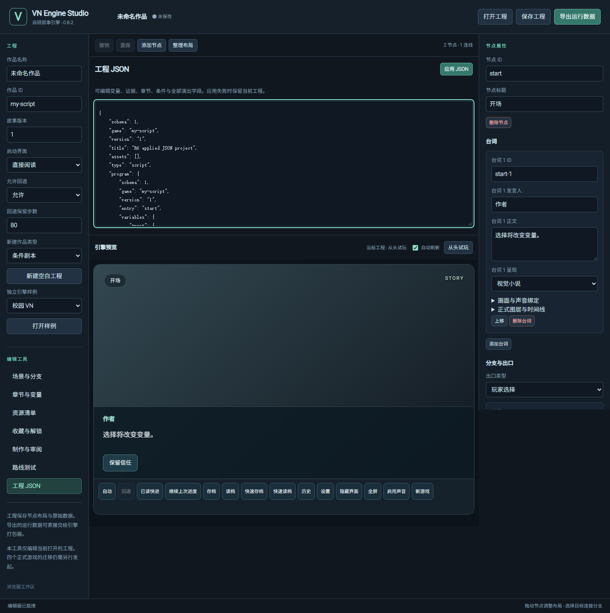

# R6 · 0.8.2 alpha 验证

日期：2026-10-30。基线：`b297a570e0156183b334552cd469ba8621abc78d`。范围及完成条件见 [R6 计划](R6_PLAN.md)，问题对应见 [R6 问题表](R6_BUGS.md)。

## 实机发现与修后复测

在本机 Windows Edge 实际控制 `http://127.0.0.1:4173/editor/`，使用独立技术工程与同一自研预览，不改四作数据。

- 旧版：编辑未应用 JSON 后，再点当前“工程 JSON”页签，无确认恢复旧标题；隐藏界面后按 H 无变化，鼠标恢复后再按 H 也无变化。
- 修后 0.8.2：输入“R6 实机复测保留的 JSON”，重复点击当前页签后原文仍保留；点击应用后工程标题实际更新。鼠标隐藏 → H 恢复 → H 隐藏 → 鼠标恢复 → 数字 1，预览实际进入结局，焦点始终留在有效阅读宿主。
- 首句音效丢失由 Node 和真实 HTMLAudioElement 受控回归确认：标题开始 / 新游戏确认后旧码创建 0 个首句音效，下一句同 WAV 正常播放。修后检验播放实例、调用次数、currentTime 和停止边界；未以此声称主观听感验收。

## 本地检查

| 检查 | 实际结果 |
| --- | --- |
| `npm run check` | Node 246 项中 242 通过，4 项在旧符号链接夹具创建时 EPERM 中断；没有跳过断言或改 OS 权限。完整核心以 Linux CI 为准 |
| 后续核心子项 | Python 6 项、179 项来源、schema、四份开发样例契约均另行通过 |
| 完整浏览器 / Studio | 本机 Edge 完整 `npm run test:browser`、`npm run test:editor` 均通过，包含 R1—R6 与生成包子目录断网重开 |
| R6 Studio | 6 组通过：同页签有效 / 无效原文、草稿重载、实际应用及导出字节、离开取消 / 同意、立即刷新后不复活已丢弃草稿 |
| R6 运行时浏览器 | 4 组通过：H / Enter / 数字键，外部与面板输入，真实音频首句延迟与同实例续播，访问 / 读档 / 回看 / 回退 / 销毁边界 |
| 媒体与稳定性 Node | 25 / 25 通过，含嵌套暂停、禁用、错误、旧 Promise 与待播消费 |
| R6 打包 | 13 / 13 通过：大小写、非相邻祖先冲突、共享资源、完整空目标发布、晚出现文件、junction、暂存修改 / 新文件保留 |
| 独立审查 | 运行时、Studio 和打包交叉检查；立即刷新草稿与非相邻前缀两项缺口已补回归；双发布实测一成一拒且无混合快照 |

四样例首次在源码提交前执行：路线、文件、解码均 PASS，生成包的 `UNVERIFIED` 身份按设计被成品校验拒绝。源码提交后使用真实提交 SHA 重验，结果与确切 CI 身份另记在本轮 PR；不将未锁定身份的首次运行标为通过。详细本地执行结果同时记录于 [机器记录](r6-validation.json)。截图来自隔离 Edge 自动回归，不冒充人工操作截图。

## 旧码失败与审查修正

- `r6-studio-before.log`：同页签原文断言失败。首版修复后审查发现丢弃草稿仍经 350ms debounce；冻结该定时器、明确丢弃、立即刷新可复活旧原文。改为同步持久化；只将修正改回 debounce 的受控旧逻辑再次确定失败，见 `r6-studio-debounce-before.log`。
- `r6-baseline-media.log`：新增媒体边界在旧码 3 项失败。`r6-baseline/r6-runtime/` 的旧码真实浏览器 2 组失败 / 2 组通过，分别命中隐藏焦点和首句音效。
- `r6-package-before.log`：先写的 7 项在旧实现 1 通过 / 6 失败。Windows `Index.html` 素材被生成 `index.html` 覆盖但构建仍成功；snapshot-ready 后新建用户文件也被覆盖。
- 打包初稿只比较排序相邻路径，漏掉 `a`、`a-foo`、`A/b`；交叉审查复现后改为检查每级祖先并补回归。

以上日志留在忽略的 `test-results/`；新增 CI 专项及 JUnit / JSON / 截图由对应工作流上传，历史失败不标记为成功。

## 输出保护与验收边界

游戏和 Studio 共用 `tools/package-output.mjs`。先预检便携路径，再将完整字节写入独占同级暂存目录，发布前复核新 / 空目标及可见符号链接。已有空目标的 `rmdir → rename` 存在短窗口；这不是防御恶意进程瞬间替换 OS 祖先的沙箱。失败清理不递归删除输出，暂存只清理身份和内容仍相同的本次文件及空目录；被修改或新加入的数据会保留。

浏览器、Windows 原生 WebView2 与完整进程重启分别执行。系统对话框使用 CI 预设路径，不冒充人工操作。本轮不更改工程 / 存档 schema，不执行正式游戏迁移，也不以技术 PASS 代替 DRAFT 素材或正式内容终审。

最终交付要求本轮 PR 的 Engine / Windows 检查成功并合并，再核验 [实际 main 工作流](https://github.com/AureliusWu/VN-Engine-v2/actions?query=branch%3Amain)。确切提交、run 链接与合并结果记录在本轮 PR 描述；本页保留本地与旧码证据，不提前写入尚未执行的原生成功结果。
