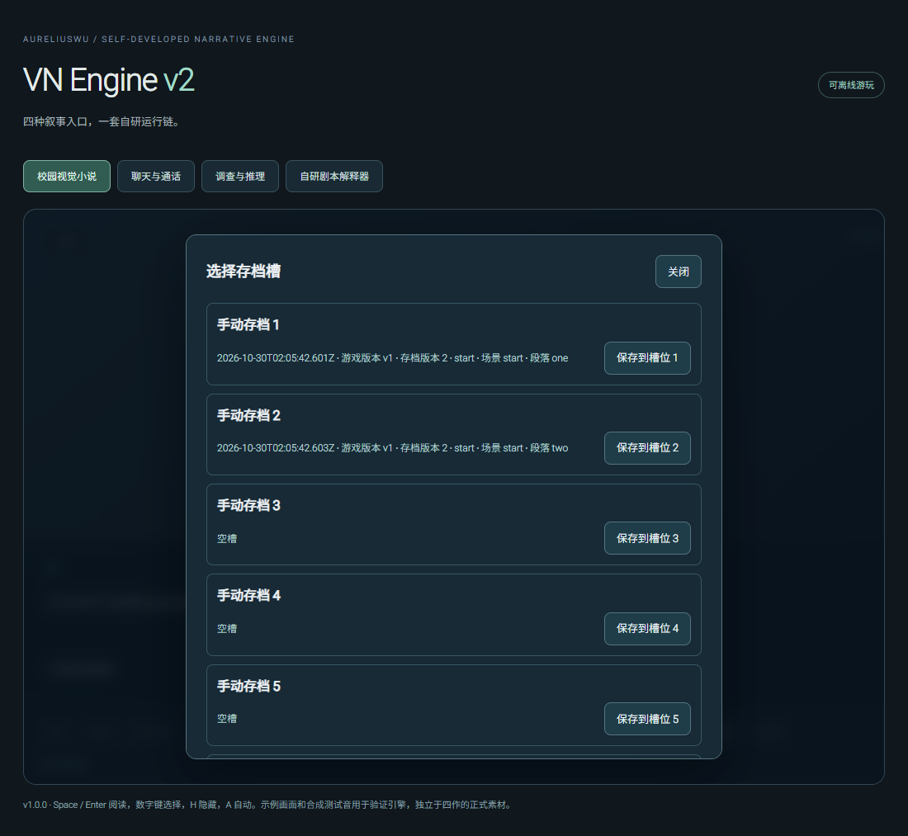

# v1.0.0 验证

日期：2026-10-30。基线：`a6b54f68412c91a7e64d0a88149a216595f61cdd`（0.8.2）。本次按 [方案](V1_PLAN.md) 收敛作者、交互、渲染、兼容四阶段；R7—R10 的上一轮只有预检，不冒充四次独立发布。

## 检查范围与证据

| 检查 | 已执行结果 |
| --- | --- |
| TypeScript / 统一版本 | 1.0.0 构建通过，npm / lock / 导出版本 / Windows assembly 一致性由既有版本测试核对 |
| 本机 `npm run check` | Node 251 项中 247 通过，4 项在旧符号链接夹具创建时报 Windows EPERM；关键符号链接场景断言未执行到，未跳过断言或更改 OS 权限。完整核心以 Linux CI 为准 |
| 独立执行剩余核心子项 | Python 6 项、180 项来源、schema、四样例开发契约通过 |
| 完整浏览器 / Studio | 本机 Edge 完整 `npm run test:browser` 与 `npm run test:editor` 均通过；新增等待修正同时经独立完整生产脚本和最终完整 Studio 覆盖 |
| v1 Studio | 8 组通过：browser / controlled native 后选优先、raw 编辑、同身份工作区替换、旧错误 / 取消 / 重试、保存快照 / 应答顺序 / 新文档、资源绑定顺序与编辑保护 |
| v1 播放器 | 5 组通过：确认 / 取消焦点、Enter / Escape、错位 quick / manual 拒绝、合法存读档、存储不可用与外部焦点 |
| v1 渲染 | 5 组通过：初始 / 动态系统减少动态、正常暂停与用户设置并集、失败图片跨访问重试 / 缓存 / 无 tick 风暴、旧请求与销毁清理 |
| 存储与旧版兼容 | 新增 4 组存储 + 1 组实际 0.8.2 golden fixture 通过；旧 persistence / continuation / backup 相关 Node 与浏览器兼容通过 |
| 独立审查 | 作者与存储 / DOM 交叉审查无剩余阻断项，另验证同 ID 在途 probe 复用和旧访问失败不能影响新图片；发现的二次展开确认失焦已补修复与断言 |

完整浏览器与 Studio 的最终本地结果记录于 [机器记录](v1-validation.json)。截图来自隔离自动回归，不是人工桌面截图。

## 旧码失败与修正记录

- `v1-studio-before.log`：新 8 组在旧码 7 失败 / 1 通过，分别命中保存误标、打开覆盖和资源目录串工作区。
- `v1-storage-before.log`：4 组旧码 3 失败 / 1 通过；`v1-player-before.log`：5 组旧码 3 失败 / 2 通过。初版取消修复后，Enter 二次展开确认仍因 disabled 原按钮失焦；保留失败并补默认取消焦点，没有放宽 Escape 或原字节断言。
- `v1-render-baseline.log`：旧码 5 组中 4 失败 / 1 通过，系统偏好模拟和临时图片 503 均可重复复现。正常动画 / 视频 / Key Visual / 稳定性兼容另行执行。
- 旧生产审阅测试仅等待相同 ID 的 fresh 徽标，会在新文件仍挂起时提前通过；受控慢读取已证明该竞态（`v1-baseline/production-review-wait.json`）。只加强两次有效导入的完成等待，改为确认旧 file input 被成功导入后的重建替换；未放宽后选优先，也未删除原业务断言。加强后的独立完整生产脚本通过，后续完整 Studio / CI 执行最终测试版本。
- golden fixture 由当时实际 0.8.2 dist 生成，producerCommit 为基线。夹具准备与测试最初曾遗漏 createProject 的 baseURL、误用不存在的 reveal 方法，属于测试调用错误；按公开 API 改为显式 baseURL / configure 后，0.8.2 与 1.0.0 均通过，不将其列为引擎缺陷。

以上旧码与过程日志位于忽略的 test-results；CI 上传当前 v1 JSON / JUnit / 截图及完整日志，历史失败不冒充通过。

## 人工、模拟与原生执行边界

上一任务的 Windows 实机控制因工具无法可靠确认 Edge URL 而终止，本次没有重新声称人工桌面逐项复测完成。v1 浏览器使用本机 Edge 隔离 headless；系统减少动态通过浏览器媒体偏好模拟，不修改用户 OS。真实原生程序、文件 IO 和完整进程重启由 Windows CI 单列验证。

作者专项的 controlled native bridge 可控制应答次序，只证明界面快照与操作身份保护，不是物理文件倒序写入的模拟。真实 HostWindow 同步处理命令，以 bridgeBusy 拒绝嵌套处理；保存使用目标锁与已观察 SHA 冲突检查。该机制不宣称抵抗忽略锁的任意外部进程 OS 级竞态。

独立样例仍为 DRAFT，正式内容总门禁可能保持 BLOCKED；引擎版本升级不会将其改为通过。实体手机、主观听感、未列明浏览器和签名发行均不据自动回归标记验收。

## 提交与交付

源码提交后使用真实 SHA 重验四样例路线、文件、解码和新构建身份；完整 PR Engine / Windows 成功后合并，再核对实际 main 两条工作流、本地同步、干净工作区和临时分支清理。确切 SHA / run 链接与结果保存在本次 PR 描述，避免把 PR merge-test 身份当作 PR head 或最终 main。
